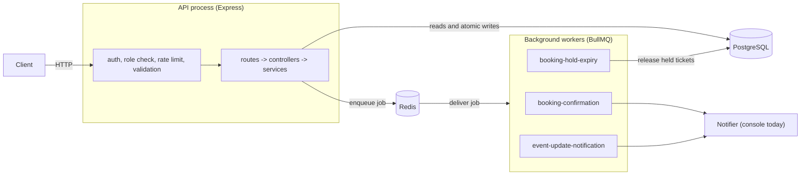
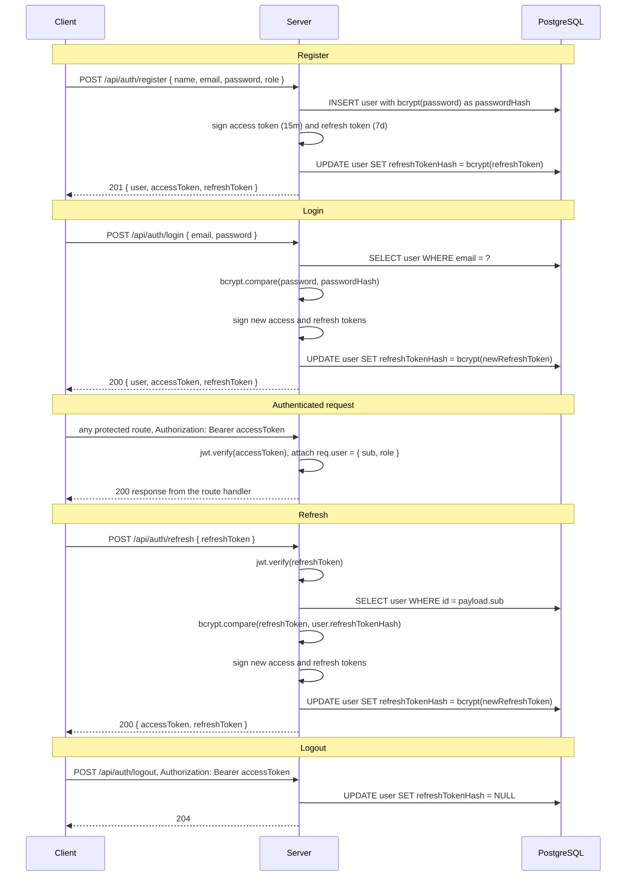
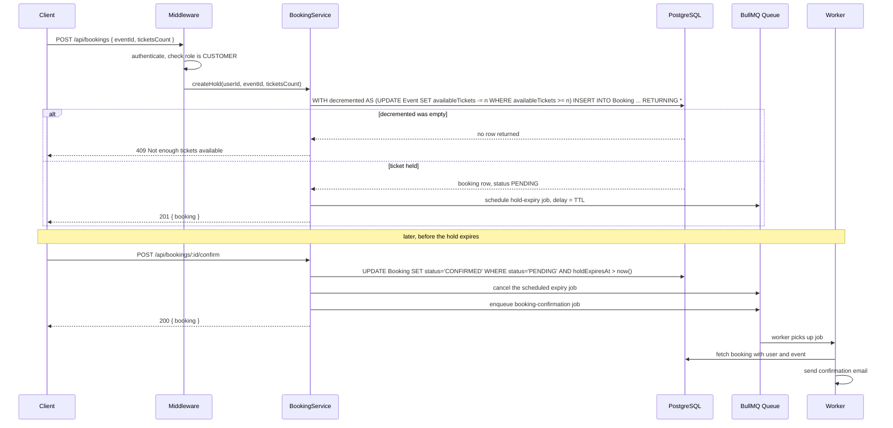
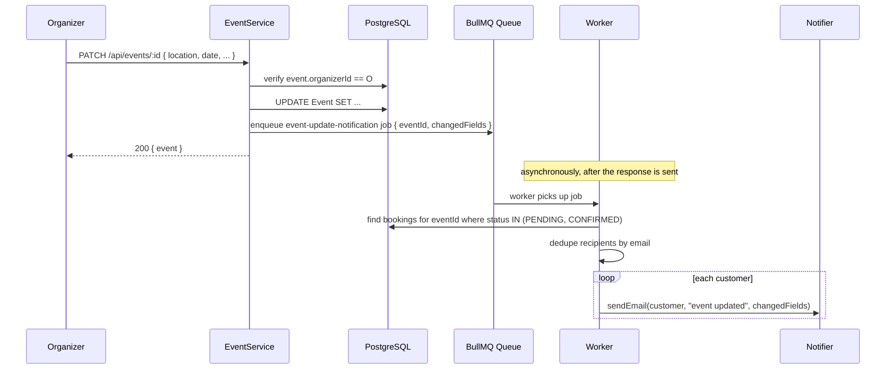
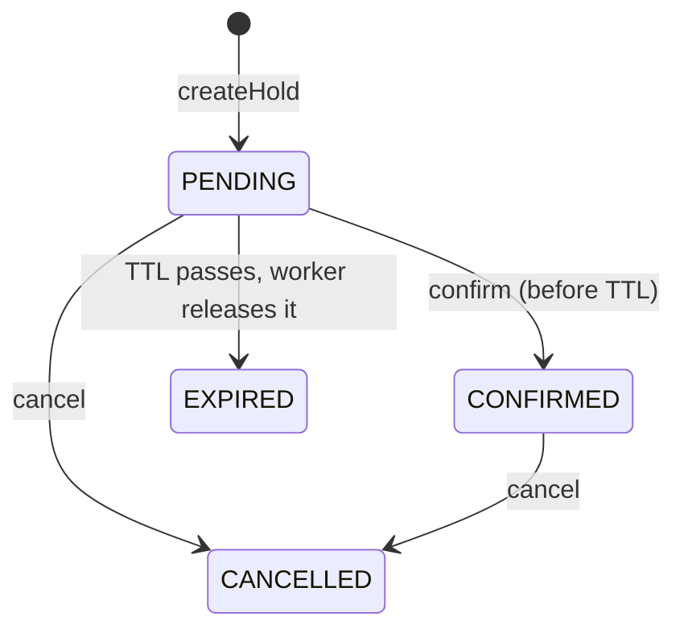
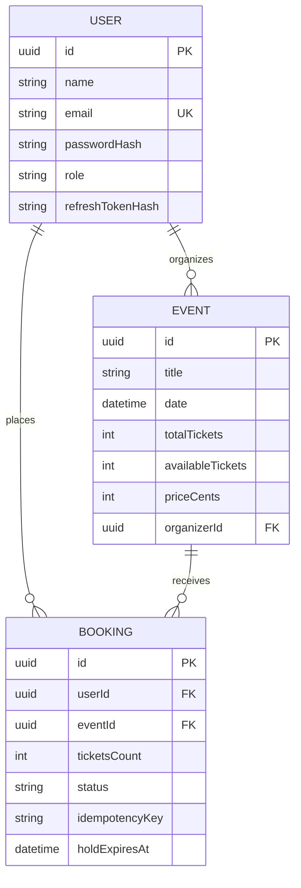

# goodPlans

goodPlans is an event booking API built with Node.js, Express, TypeScript, Prisma, and PostgreSQL. Organizers create and manage events. Customers browse events, book tickets, confirm or cancel those bookings. Redis backs a BullMQ job queue that handles booking confirmations and event update notifications in the background. It deploys to Railway.

Most of this README covers how things work. The "Decisions Log" section near the end covers why, including the alternatives that got ruled out along the way.

## Tech Stack

| Technology | Why |
|---|---|
| Node.js + Express | Simple, well understood request/response model, no framework magic to fight |
| TypeScript | Catches a whole class of bugs at compile time, makes refactors less scary |
| Prisma | Type-safe queries and migrations, and it lets you drop to raw SQL when the generated query API isn't enough (more on that below) |
| PostgreSQL | Booking a ticket is a write that has to be correct under concurrency, and Postgres gives you real transactions and row locks to build that on |
| Redis | Backs the BullMQ job queue |
| BullMQ | Durable job queue with retries, so background work survives a worker restart or a transient failure |
| bcryptjs | Hashes passwords and refresh tokens |
| jsonwebtoken | Signs and verifies access and refresh tokens |
| express-validator | Request validation without hand-rolling if-checks in every controller |

## Architecture Decisions

### Controller, service, route split

Routes wire up middleware (auth, role checks, validation) and point at a controller. Controllers only touch `req` and `res`. Services do everything else: database queries, queue jobs. No service function ever receives `req` or `res`. This is enforced by convention, not by the framework, so it depends on people actually following it, but it means service functions are callable from a test or a script without faking an HTTP request.

### Booking is a hold, not an instant confirmation

A customer calling the booking endpoint doesn't immediately get a confirmed ticket. It creates a `PENDING` booking that holds the ticket for five minutes. The customer then has to call a confirm endpoint. If they don't confirm in time, a background job releases the ticket automatically.

This mirrors how real ticketing and payment systems work: you reserve the seat, give the customer a window to actually finish paying, and let it go if they don't. There's no real payment step in this exercise, so the confirm endpoint is standing in for "payment succeeded." It felt more honest to model that boundary explicitly than to pretend a booking is final the instant someone clicks a button.

A booking moves through four states:

```
PENDING -> CONFIRMED -> CANCELLED
PENDING -> CANCELLED
PENDING -> EXPIRED  (hold TTL passed without a confirm)
```

### Preventing overbooking

Two customers hitting the last ticket at the same moment is the scenario that actually matters here. If you read `availableTickets`, check it in your application code, then write the decremented value back, there's a window between the read and the write where a second request can read the same stale value. Both requests pass the check, both decrement, and the event sells one more ticket than it has.

The fix is to never separate the check from the write. Everything that touches ticket inventory happens as a single conditional `UPDATE`:

```sql
UPDATE "Event"
SET "availableTickets" = "availableTickets" - N
WHERE id = $eventId AND "availableTickets" >= N
```

If the row doesn't match because someone else already took the last ticket, zero rows get updated and the request gets a 409. There's no gap for a second request to sneak into, because the comparison and the write are one atomic operation as far as Postgres is concerned.

Creating a hold actually does this decrement and the booking insert in one SQL statement, using a CTE:

```sql
WITH decremented AS (
  UPDATE "Event"
  SET "availableTickets" = "availableTickets" - N
  WHERE id = $eventId AND "availableTickets" >= N
  RETURNING id
)
INSERT INTO "Booking" (...)
SELECT ... FROM decremented
RETURNING *
```

If `decremented` comes back empty, the `INSERT ... SELECT` inserts nothing. One statement, one round trip to the database, and the booking row only gets created if the decrement actually happened.

The same "guard the update by current state, don't check state in a separate read" rule applies to confirming, cancelling, and expiring a booking too. Confirming only succeeds if the booking is still `PENDING` and the hold hasn't expired yet:

```sql
UPDATE "Booking" SET status = 'CONFIRMED'
WHERE id = $id AND status = 'PENDING' AND "holdExpiresAt" > now()
```

Cancelling and expiring release the ticket back to the event, guarded by the booking's current status:

```sql
UPDATE "Booking" SET status = $to
WHERE id = $id AND status IN ($from...)
-- ticket only gets incremented back if this actually matched a row
```

It's easy to get this right on the "take a ticket" side and forget it on the "give one back" side. If cancelling checked the booking's status with a plain `findUnique` first and then unconditionally updated it, two concurrent cancel calls on the same booking could both pass that check and both release a ticket, and now `availableTickets` is higher than `totalTickets`. Guarding the update itself closes that gap, because Postgres serializes writes to the same row: whichever `UPDATE ... WHERE status = 'CONFIRMED'` lands first flips the status, and the second one's `WHERE` clause no longer matches anything. `tests/booking-concurrency.test.ts` fires 10 concurrent cancels at the same booking and checks the ticket only gets released once, so this is tested, not just argued for in a README.

### Idempotency on booking creation

A client can retry a `POST /bookings` call for all sorts of reasons: a timeout, a double click, a flaky connection. Without protection, a retry creates a second real booking and takes a second ticket for the same intent. The booking endpoint accepts an `Idempotency-Key` header, and that key is stored as a column on the `Booking` row under a unique database constraint, `(userId, idempotencyKey)`. A repeated request with the same key just returns the original booking. This lives in Postgres rather than only in Redis so the guarantee survives a Redis restart or eviction, not just a happy path.

### Hold expiry

When a hold is created, a BullMQ job gets scheduled to fire after the hold's TTL (5 minutes by default). The job checks if the booking is still `PENDING` and releases it if so, using the same guarded update described above. If the customer confirms before the job fires, the job gets cancelled so it doesn't do pointless work. If confirm and expiry happen to race anyway, it's the database guard on status that actually decides the outcome, not whichever side got to cancel the job first.

### Background jobs

Calling an email send directly inside the request handler would make the customer wait on it, and if it fails you're either returning a 500 for something they didn't cause or silently swallowing the error. BullMQ decouples this: `queue.add(...)` serializes the job into Redis and returns immediately, and a separate worker process picks it up. Jobs live in Redis, not in process memory, so they survive a server restart.

There are two jobs:

- **Booking confirmation.** Fires when a hold gets confirmed, not when it's first placed, since confirming is the point where there's actually something to confirm. The worker refetches the booking with its event and user, and sends the email.
- **Event update notification.** Fires when an organizer edits an event. The worker finds every customer with a `PENDING` or `CONFIRMED` booking on that event, dedupes by email (someone could have booked twice), and notifies each one.

Both queues retry a failed job up to 5 times with exponential backoff, so a database blip while a job is running doesn't just drop it on the floor.

Neither job sends a real email. They log through a `Notifier` interface in `src/lib/notifier.ts` that has exactly one method, `sendEmail`. Swapping in SES or Resend or anything else later means writing one new file that implements that interface, nothing else in the codebase needs to change.

### Rate limiting, keyed by user on the booking route

Auth endpoints (login, register) are rate limited by IP, which makes sense there since there's no logged-in user yet to key on, and the thing you're defending against is brute forcing credentials from one source.

The booking endpoint is limited per authenticated user instead of per IP. If it were keyed by IP, every customer sitting behind the same NAT, office network, or (as I found out running the load test from one machine against many simulated customers) the same test harness, would share one limit and start getting blocked on each other's behalf. Keying by user id means the limit actually protects against one account hammering the endpoint, which is the thing worth protecting against here.

### Pagination and indexes

`GET /events` and `GET /bookings/my` both take `page` and `pageSize` query params instead of returning the whole table. And the schema has indexes on `Event.organizerId`, `Event.date`, `Booking.userId`, `Booking.eventId`, and a composite index on `Booking.[eventId, status]` for the "how many active bookings does this event have" query that runs on event deletion and in the notification worker.

### Config and errors

Required environment variables are validated at startup (`src/config/env.ts`), so a missing `DATABASE_URL` fails loudly when the process boots instead of failing weirdly on the first request that needs it.

Every error response has the same shape, `{ success: false, code, message }`, and every success response looks like `{ success: true, data }`. One error-handling middleware is responsible for this, and it also catches Prisma's own error codes (like a unique constraint violation) and turns them into a proper 409 or 404 instead of letting a raw 500 leak out.

Every request gets a request id, attached by a small middleware and echoed in every log line for that request (via pino-http). That way a line logged by a background worker two minutes later can still be traced back to the request that triggered it.

## Database Schema

Three models: User, Event, Booking.

A User has a role of either `ORGANIZER` or `CUSTOMER`. The password is stored as a bcrypt hash. The refresh token is also hashed before being stored, not kept as a plain string, since a leaked database shouldn't hand over usable session tokens.

An Event belongs to one organizer and has `totalTickets` and `availableTickets` as separate integer columns. `availableTickets` is stored directly rather than computed by counting bookings on every read, both because counting on every read gets slow and because it would make the atomic decrement a lot messier to write. The tradeoff is that every place that changes a booking's status also has to update this column, which is exactly what the guarded updates above are doing. `totalTickets` can't be changed after the event is created. Letting an organizer shrink capacity below what's already booked opens a reconciliation question that isn't worth solving here, so if capacity needs to change, the event gets cancelled and recreated. Price is stored as `priceCents`, an integer, instead of a float or a decimal column, since integer minor units is the normal way to avoid rounding surprises with money.

A Booking belongs to one User and one Event, and records how many tickets, a status, and a hold expiry time. Cancelled and expired bookings stay in the table rather than getting deleted, both for auditability and because the state machine is simpler to reason about when the record just exists in a different state.

## API Reference

### Auth

| Endpoint | Auth | Role | Description |
|---|---|---|---|
| POST /api/auth/register | No | Any | Create a new account |
| POST /api/auth/login | No | Any | Log in and receive a token pair |
| POST /api/auth/refresh | No | Any | Exchange a refresh token for a new pair |
| POST /api/auth/logout | Yes | Any | Invalidate the stored refresh token |

### Events

| Endpoint | Auth | Role | Description |
|---|---|---|---|
| GET /api/events | No | Any | List events, paginated |
| GET /api/events/:id | No | Any | Get one event |
| POST /api/events | Yes | ORGANIZER | Create an event |
| PATCH /api/events/:id | Yes | ORGANIZER | Update an event you own, triggers the notification job |
| DELETE /api/events/:id | Yes | ORGANIZER | Delete an event you own, rejected if it has active bookings |

### Bookings

| Endpoint | Auth | Role | Description |
|---|---|---|---|
| POST /api/bookings | Yes | CUSTOMER | Place a hold on tickets, `Idempotency-Key` header optional |
| GET /api/bookings/my | Yes | CUSTOMER | List your own bookings, paginated |
| GET /api/bookings/:id | Yes | CUSTOMER | Get one of your own bookings |
| POST /api/bookings/:id/confirm | Yes | CUSTOMER | Confirm a pending hold before it expires |
| POST /api/bookings/:id/cancel | Yes | CUSTOMER | Cancel a pending or confirmed booking |

## Local Setup

1. Install dependencies: `pnpm install`
2. Copy `.env.example` to `.env` and fill in `DATABASE_URL`, `REDIS_URL`, and the JWT secrets
3. Create the database and apply migrations: `pnpm run db:deploy`
4. Have Postgres and Redis running locally
5. Start the server: `pnpm run dev`
6. Confirm it's up: `GET http://localhost:3000/health`

## Testing

Five integration tests, each one aimed at a specific way this kind of system tends to break, not generic CRUD coverage:

1. **Overbooking race.** 30 concurrent holds against 10 tickets. Exactly 10 succeed.
2. **Double release race.** 10 concurrent cancels of the same booking. The ticket gets released exactly once, not ten times.
3. **Idempotency.** A retried booking request with the same idempotency key returns the original booking instead of creating a second one.
4. **Hold expiry.** An unconfirmed hold actually gets released by the real BullMQ worker after its TTL, and a confirm that lands before expiry correctly cancels the scheduled release.
5. **Access control.** A customer can't create or edit events, an organizer can't touch another organizer's event, and a customer can't read another customer's booking by guessing its id.

```bash
pnpm test
```

## Performance

The assignment asks for an actual stress test of the booking endpoint, with a real breaking point, not a description of one. `load-test/run.ts` seeds one event with a huge ticket count and one distinct customer per concurrent connection, then fires a burst of simultaneous booking requests at increasing concurrency, from 10 up to 1200, using autocannon.

My first guess at what would limit throughput was Prisma's connection pool size. I ran the same code with a small pool (5 connections) and a larger one (20 connections) and got almost identical latency curves either way, so that wasn't it.

What's actually going on: every hold on the same event serializes on that event row's lock in Postgres. That's not a bug, it's the cost of using a conditional atomic update for correctness. What you can control is how long each request holds that lock. The first version of `createHold` ran the decrement and the booking insert as two separate statements inside an explicit transaction (begin, update, insert, commit, four round trips to the database while the lock is held). Rewriting it as the single CTE statement shown earlier cuts that down to one round trip.

| Concurrent customers | Before, p50 / p99 | After, p50 / p99 | Before req/s | After req/s |
|---:|---:|---:|---:|---:|
| 10 | 77ms / 80ms | 44ms / 53ms | 10 | 10 |
| 100 | 175ms / 177ms | 77ms / 109ms | 100 | 100 |
| 400 | 573ms / 590ms | 206ms / 383ms | 400 | 400 |
| 800 | 1100ms / 1138ms | 433ms / 679ms | 400 (saturated) | 800 |
| 1200 | 1577ms / 1633ms | 495ms / 1009ms | 600 | 600 |

Before the rewrite, throughput flattens out around 400 requests per second once concurrency passes 400. It's still correct the whole time (zero overbooking, confirmed by the concurrency tests), but latency climbs roughly linearly as requests queue up for the same lock, and by 1200 concurrent customers p99 is past 1.6 seconds. If you set the bar at "p99 under a second is fine, past that it's degraded," that version's breaking point is somewhere around 600 to 700 customers booking the same event at once.

After the rewrite, the same 800-customer burst that maxed the old version out at 400 req/s now sustains 800 req/s with p99 under 700ms. Throughput roughly doubled, and the point where p99 crosses one second moves out past 1200 concurrent customers. Both columns are from real runs, saved in `load-test/results/baseline.json` and `load-test/results/optimized.json`.

One note on reproducing this: `pnpm run load:baseline` and `pnpm run load:optimized` only vary the connection pool size, because the "before" code no longer exists in the repo, it was rewritten. The "before" numbers above came from running the stress test against that earlier version before it got replaced. The fix is in the code now, not behind a flag, so running `load:baseline` today exercises the current, already-fixed `createHold` with a smaller pool, which is close to but not identical to the original "before" numbers.

If I had more time, the next lever would be moving the hot-path counter out of Postgres entirely, into something like a Redis `DECR` or a small Lua script, and reconciling it back into Postgres asynchronously through the existing job queue. That removes the row lock from the request path altogether. I didn't do that here because it trades a single obviously-correct source of truth for a system where the cache and the database can briefly disagree, and that tradeoff wasn't worth making for this exercise.

### Running it yourself

```bash
pnpm run load:baseline
pnpm run load:optimized
```

## System Diagrams

### Architecture



Workers run in the same process as the API for this exercise. `src/server.ts` starts all three alongside the HTTP server. At real scale they'd run as a separate deployment, so a burst of booking traffic doesn't compete with job processing for the same connection pool.

### Auth flow



### Booking flow



### Event update notification flow



### Booking states



### Data model



## Decisions Log

The sections above cover how things work. This is a log of why they ended up this way instead of some other way, including the alternatives that were considered and set aside.

### 1. Rebuilt from scratch, same stack

Node, Express, TypeScript, Prisma, Postgres, Redis, BullMQ. This isn't the first time this assignment got done. The earlier pass got the hardest part right (the atomic decrement that prevents overbooking on create) but had a mirrored bug on the cancel path, no indexes, no idempotency, no load-test evidence, and a route that was missing its role check. Patching that codebase in place was an option. Starting clean was chosen instead, so every piece gets built with the lessons already applied rather than retrofitted, and so the commit history tells a straight story instead of a "fix the old thing" story.

### 2. Booking is a hold with a TTL, not an instant confirmation

Considered: keep it simple, two states, `CONFIRMED` or `CANCELLED`, matching how a lot of booking demos work.

Decided instead: a booking starts `PENDING`, holds a ticket for 5 minutes, and either gets confirmed or expires automatically. This is closer to how real ticketing and payment systems actually behave, there's a reservation step before money changes hands, and it gives the system something real to test (a timed, automatic release) instead of only testing the happy path. There's no real payment integration here, so the confirm call is standing in for "payment succeeded." That's a scope decision, not an oversight, and it's called out as one rather than dressed up as something it isn't.

### 3. Every inventory change is one guarded SQL statement, never read-then-write

This is the actual correctness requirement of the whole system: don't check `availableTickets` in application code and then write a new value back, because the gap between the check and the write is exactly where two concurrent requests both succeed and the event sells more tickets than it has.

Decided: every transition that touches ticket counts (create a hold, confirm, cancel, expire) is a single `UPDATE ... WHERE <current state matches>` statement. The database's own row-level locking does the serialization. Creating a hold goes one step further and does the decrement and the booking insert in one CTE statement instead of two statements inside an explicit transaction, because the load test showed that the time spent holding that row's lock is the actual throughput ceiling on a popular event, and fewer round trips while the lock is held means a higher ceiling. See the Performance section above for the actual numbers.

The alternative that got ruled out partway through: guarding the "take a ticket" direction carefully and checking status with a plain read before the "give a ticket back" direction (cancel, expire). That asymmetry is exactly the kind of bug that's easy to miss, since the happy path still looks correct. Both directions use the same guarded-update pattern now, and there's a test (`tests/booking-concurrency.test.ts`) that fires concurrent cancels at one booking specifically to catch a regression here.

### 4. Idempotency key lives in Postgres, not just Redis

Considered: cache the idempotency key and its result in Redis with a TTL. Fast, and Redis is already in the stack for the job queue.

Decided instead: the key is a column on `Booking` with a unique constraint across `(userId, idempotencyKey)`. The guarantee that a retried request can't double-book needs to hold even if Redis is down or has evicted the entry, and a database constraint doesn't have that failure mode. Redis would still be a reasonable place to cache the full response for a faster round trip on a repeat request, but that's a latency optimization, not a correctness requirement, and it wasn't worth the extra moving part here.

### 5. Rate limiting is keyed by user on the booking route, by IP on auth routes

The obvious first implementation is to rate limit everything by IP. That's wrong for the booking route specifically: the thing worth limiting is one account hammering the endpoint, and a shared IP, whether that's a NAT, a corporate network, or (as came up directly while building the load-test harness) one machine simulating a thousand different customers, isn't the same thing as one account. Auth routes stay IP-keyed because there's no authenticated identity yet to key on, and the thing being defended against there (credential stuffing, brute force) actually is a source-IP problem.

### 6. Single-session refresh token, hashed, not a session table

Considered: a `Session` table keyed by device, so a user can be logged in on a phone and a laptop at once and log out of just one.

Decided instead: one refresh token per user, hashed with bcrypt before it's stored, rather than kept as a plain string. This closes the "database leak hands out usable session tokens" problem, which felt like the one actually worth fixing given the time available. Multi-device sessions are a real gap this leaves open (logging in on a second device invalidates the first), and that's a straightforward next step, a `Session` table with one row per device instead of one token column on `User`, just not one that fit the time budget for this pass.

### 7. Ticket inventory stays in Postgres, not Redis

The load test's real finding was that a popular event's row lock, not connection pool size, is what limits throughput. The fix applied here (fewer round trips per hold, via the CTE rewrite) works within "Postgres is the single source of truth for ticket counts." A different fix exists: move the hot-path counter into Redis (an atomic `DECR` or a small Lua script) and reconcile it back into Postgres asynchronously through the job queue that's already there. That removes the row lock from the request path entirely and would likely raise the ceiling further.

It wasn't implemented. The tradeoff is real: a Redis-backed counter means the cache and the ledger can disagree for a short window, and reconciling that correctly (what happens if the worker crashes mid-reconciliation, what happens on a Redis failover) is a meaningfully bigger problem than the one being solved in this exercise. One obviously-correct source of truth, with a known and documented ceiling, was judged better than a faster system with a harder-to-reason-about failure mode, given the time available. If the event volume ever actually demanded it, this is the next lever.

### 8. Workers run in the same process as the API

Considered: a separate worker entrypoint, deployed as its own process, so a spike in booking traffic doesn't compete with job processing for the event loop or the database connection pool.

Decided instead, for this exercise: `src/server.ts` starts the HTTP server and all three BullMQ workers together. Splitting them is mechanical (the worker files already exist as standalone functions, `startBookingConfirmationWorker` and friends, so pulling them into a second `worker.ts` entrypoint and a second Railway service is a small change) but it doesn't change the correctness story being demonstrated here, and wasn't worth the setup time against everything else in scope.

### 9. Load test measures a concurrency burst, not sustained throughput

The assignment asks "how many users can it handle simultaneously," which is a question about concurrency, not about sustained requests-per-second over a long window. The load-test harness reflects that directly: each step fires exactly N requests at once (N customers, N connections, N requests, no more), rather than N connections hammering the endpoint for a fixed duration. The first version of the harness used a fixed-duration run, which had a side effect worth noting: a 10-second window with low per-request latency sends well more than 30 requests per customer, which is the rate limit, so almost everything after the first few came back as a 429 and the results were meaningless. Switching to "N customers, one request each" fixed that and also happens to match the actual question being asked.
